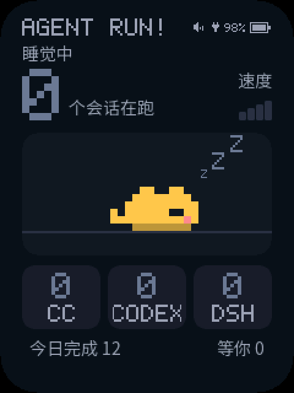
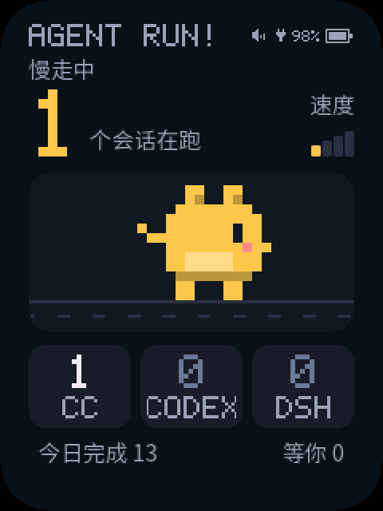
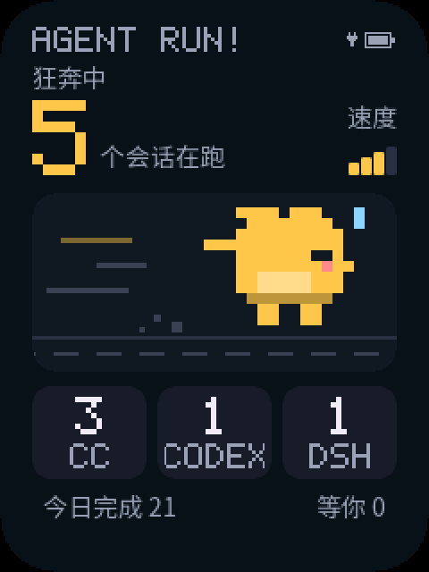
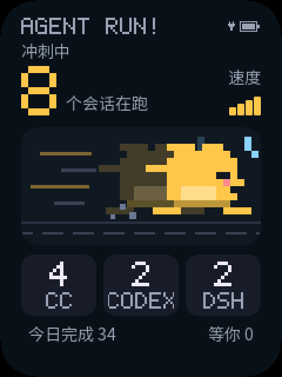
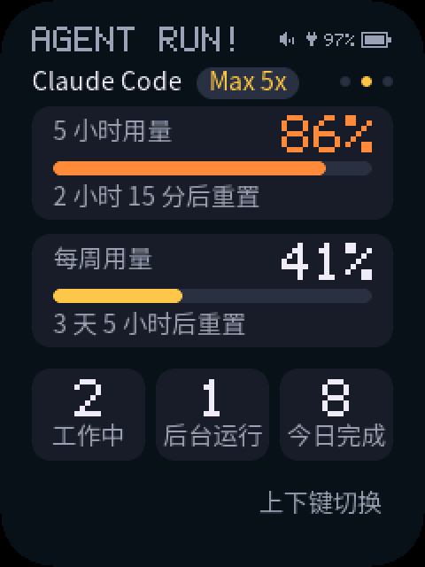
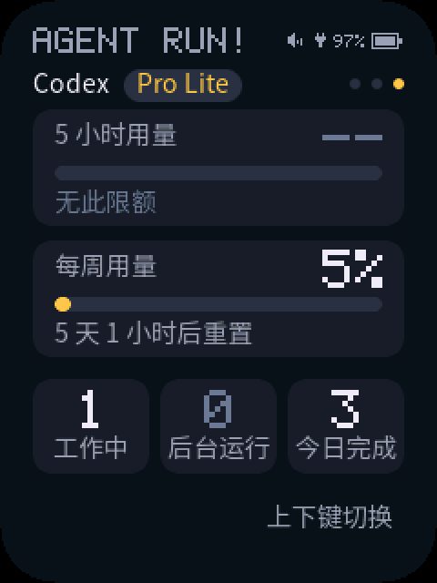
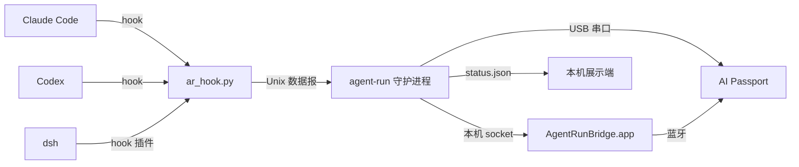

# Agent Run!

Agent Run! 把本机正在运行的 AI 编程 Agent 会话（Claude Code、Codex、dsh）汇总成一块状态牌：工作中的会话越多，宠物跑得越快；有会话在等你授权或回答时，宠物停下来招手，并响一声提醒。

当前的展示设备是 [FoloToy AI Passport](https://ai-passport.folotoy.cn/)，经 USB 或蓝牙连接电脑。展示端与采集端之间只靠一份公开的 [展示端协议](docs/protocol.md) 通信，电脑浮窗、手机锁屏等其他展示方式可以按同一协议接入。

<p align="center">
  
  
  
  
  
</p>
<p align="center"><sub>AI Passport 真机截图（经 <code>FAP_SCREENSHOT_V1</code> 串口截屏，放大 2 倍），画面中的数字为示例</sub></p>

## 功能

- **会话汇总：** 分别统计 Claude Code、Codex、dsh 正在执行任务的会话数，以及今日完成的轮数。
- **跑速档位：** 按三者合计切换动画。

  | 工作中的会话 | 0 | 1 | 2–3 | 4–6 | ≥7 |
  |---|---|---|---|---|---|
  | 画面 | 睡觉 | 慢走 | 小跑 | 狂奔 | 冲刺 |

- **等你处理：** 遇到权限请求、提问或计划确认时，立刻切到提醒画面并响一次。这个画面优先于跑速，列表里写明是哪个工具、在等什么。
- **完成提示：** 有会话完成一轮时，显示“完成 +N”并响一声轻提示音，屏幕随之点亮。
- **工具专用页面：** 用上下键在首页、Claude Code、Codex 三页之间切换。专用页面在工具名旁显示订阅类型（如 Max 5x、Pro Lite），下面是该工具的 5 小时与每周订阅用量（百分比、进度条、多久后重置，用量达到 80% 时变橙色），以及工作中、后台运行、今日完成的数量。出现等你处理时照常切到提醒画面，处理完回到原来的页面。

  <p align="center">
    
    
  </p>

- **省电：** 屏幕在通知或按键后亮起，空闲时自动调暗、熄屏；标题栏显示电量百分比，按确定键打开设置菜单调音量和亮度。
- **两种连接：** 插着 USB 时走 USB；拔掉后自动改走蓝牙，插回自动切回。
- **隐私：** 发给设备的只有计数、工具代号、原因代号和用量百分比，不含账号、项目名、路径、提示词或会话内容。

## 支持情况

| 工具 | 支持的运行方式 | 识别“等你处理” | 接入条件 |
|---|---|---|---|
| Claude Code | 桌面端、CLI、VS Code 扩展 | 权限请求、`AskUserQuestion`、`ExitPlanMode` | 执行 `install-hooks` 后自动生效 |
| Codex | 桌面端、CLI | 权限请求、`request_user_input`，以及桌面端的异步提问 `request_user_input_async` | 需在 Codex 中审查并信任新增的 hook |
| dsh | 命令行启动的 profile（如 `dsh web`） | `ask_user_question` | 需在 profile 中挂载官方插件 `@deepseek-ai/dsh-hooks-claude-code`；未挂载时只按会话文件估算“工作中” |

不支持在云端运行的会话（Claude Code on the web、Codex 云任务），因为采集程序只能接收本机的 hook 事件。DeepSeek Harness 桌面应用暂不支持识别提问，原因见 [已知限制](#已知限制)。

## 工作原理



1. 各工具在会话开始、提交提示、调用工具、请求权限、结束一轮时调用 `ar_hook.py`。它只把会话 ID、事件名和工具名转给守护进程，并始终异步、静默地退出，不影响 Agent 运行。
2. 守护进程维护每个会话的状态：工作中、等你处理或空闲。会话超时会自动回收，“今日完成”按本地日期计数。汇总结果按 [展示端协议](docs/protocol.md) 推送给设备，同时写入 `~/.agent-run/run/status.json`。
3. 设备只负责显示、动画、按键和提示音，不联网，也不保存会话信息。

事件到状态的完整映射见 [设计方案](docs/specs/2026-11-08-agent-run-design.md) §5。

## 快速开始

### 环境要求

| 组件 | 要求 | 用途 |
|---|---|---|
| macOS | 13 或更新版本 | 采集程序与蓝牙桥接只支持 macOS |
| Python | 系统自带的 `/usr/bin/python3`（3.9 及以上） | 采集程序，只依赖标准库 |
| Xcode | 含 Swift 5.9 以上的工具链 | 构建蓝牙桥接程序（只用 USB 时不需要） |
| ESP-IDF | 5.5.3 | 构建并烧录 AI Passport 固件 |

### 1. 安装采集程序

```bash
git clone https://github.com/vvnocode/agent-run.git
cd agent-run
core/bin/agent-run install-hooks     # 备份后，为 Claude Code 与 Codex 追加 hook
core/bin/agent-run install-service   # 复制到 ~/.agent-run，注册为登录自启服务
```

`install-hooks` 只在 `~/.claude/settings.json` 和 `~/.codex/hooks.json` 中追加自己的条目，不改动已有 hook；修改前的文件备份在 `~/.agent-run/backup/`。

### 2. 在 Codex 中信任 hook

Codex 只执行审查并信任过的 hook。在 Codex CLI 中执行 `/hooks`，或在桌面端打开 Settings → Hooks，信任 agent-run 新增的条目。之后执行 `agent-run status`，如果还有未信任的条目，会在末尾给出提示。

### 3. 接入 dsh（可选）

```bash
core/bin/agent-run install-dsh-hooks
dsh plugin --profile web add @deepseek-ai/dsh-hooks-claude-code@<与 dsh 相同的版本>
```

第一条命令生成 `~/.agent-run/dsh-hooks.json`，并打印需要追加到 `~/.dsh/profiles/<profile>/cordis.patch.yml` 的挂载配置。重启该 profile 后生效。插件的 peer 依赖固定到具体的 dsh 版本，版本不一致时插件无法加载。

### 4. 刷写 AI Passport

构建与烧录步骤见 [displays/ai-passport/README.md](displays/ai-passport/README.md)。刷写完成后插上 USB，执行：

```bash
~/.agent-run/bin/agent-run status   # 应显示“设备链路：已连接 …（USB）”
~/.agent-run/bin/agent-run demo     # 设备依次演示七种画面，约 42 秒
```

### 5. 启用蓝牙（可选）

```bash
transports/macos-ble/build.sh                    # 构建并安装到 ~/Applications/AgentRunBridge.app
~/.agent-run/bin/agent-run install-bridge-service
```

1. 首次运行时，macOS 会请求蓝牙权限，点“允许”。
2. 设备屏幕出现“配对这台电脑？”时，按 OK 确认。
3. 之后拔掉 USB，设备会在约 15 秒内改走蓝牙，标题栏图标由 USB 插头变为蓝牙标志。

## 命令参考

安装后，命令位于 `~/.agent-run/bin/agent-run`。

| 命令 | 作用 |
|---|---|
| `status [--events]` | 显示汇总状态、设备链路、每个工具的用量与未能更新的原因、需要处理的提示；`--events` 另列出最近 20 条事件 |
| `demo` | 让设备依次演示睡觉、慢走、小跑、狂奔、冲刺、等你处理、未连接；演示期间可以用上下键查看带示例用量的专用页面 |
| `screenshot -o 文件.png [--scale N]` | 经 USB 截取设备屏幕。截屏前要先停止守护进程：`launchctl bootout gui/$(id -u)/local.agent-run` |
| `setup` | 查找设备串口并写入 `~/.agent-run/config.json`；默认会自动查找，一般不需要 |
| `install-hooks` / `uninstall-hooks` | 安装或删除 Claude Code、Codex 的 hook |
| `install-service` / `uninstall-service` | 注册或注销采集程序的登录自启 |
| `install-bridge-service` / `uninstall-bridge-service` | 注册或注销蓝牙桥接程序的登录自启 |
| `install-dsh-hooks` | 生成 dsh 插件用的 hook 配置 |
| `run` | 在前台运行守护进程，一般由 launchd 调用 |

## 设备操作

| 操作 | 作用 |
|---|---|
| 下 / 上 | 依次切换 首页 → Claude Code → Codex → 首页（上键反向）；等你处理、未连接时不切页。所在页面熄屏后保持，重启后回到首页 |
| 确定 单击 | 打开设置菜单，默认选中“音量” |
| 菜单里 上 / 下 | 切换“音量”和“亮度” |
| 菜单里 确定 单击 | 进入选中项，用上下键调节：音量分静音、低、中、高，每按一次按新音量响一声；亮度分 5 档，调节时按设定亮度点亮。调节结果断电保存 |
| 菜单里 确定 双击 | 返回上一级：调节界面回到菜单，菜单回到首页 |
| 菜单无操作 | 菜单 10 秒、调节界面 3 秒没有按键就回到首页 |
| 上 按住 5 秒 | 清除蓝牙配对，以便改连另一台电脑 |
| 配对确认时 确定 / 下 | 接受 / 拒绝配对 |
| 任意键 | 熄屏时按下即点亮屏幕（这一下不执行按键操作）；深睡时唤醒设备 |

按键、有会话等你处理、有会话完成、连上电脑都会点亮屏幕；拔掉 USB 时屏幕若亮着，会按电池供电的规则继续亮 30 秒。有会话完成时，屏幕显示“完成 +N”，并响一声轻提示音。

- **插着电脑：** 5 分钟后调暗，30 分钟后熄屏。
- **电池供电：** 屏幕亮起时直接用低亮度，30 秒后熄屏。熄屏满 1 小时，或设备显示“未连接”且 30 分钟内没有按键，就会关机（深睡）省电，按任意键唤醒后会自动重连。连着电脑时，每次等你处理和会话完成都会亮屏并重新计时。

## 故障排查

| 现象 | 处理 |
|---|---|
| Codex 跑任务时计数不变 | 执行 `agent-run status` 检查是否有未信任的 hook，按提示在 Codex 中信任 |
| dsh 提问不提醒 | 确认所用 profile 已挂载 `dsh-hooks-claude-code` 插件，且版本与 dsh 一致；DeepSeek Harness 桌面应用暂不支持 |
| 设备一直显示“未连接电脑” | 用 `agent-run status` 检查守护进程是否在运行；用 `--events` 查看事件是否到达 |
| 烧录工具报端口被占用 | 守护进程会占用串口，烧录前执行 `launchctl bootout gui/$(id -u)/local.agent-run` |
| 烧录后设备不响应 | 偶发现象，按电源键重启设备即可 |
| 桥接日志出现 `Peer removed pairing information` | 设备上的配对已被清除（例如从 `0x0` 烧录过合并镜像）。在 系统设置 → 蓝牙 中忽略 `AgentRun-XXXX`，再在设备上确认重新配对 |

日志位置：`~/.agent-run/log/agent-run.log`（采集程序）、`~/.agent-run/log/bridge.log`（蓝牙桥接）。

## 已知限制

- **Claude Code 用量需要登录 CLI：** 采集程序从钥匙串条目 `Claude Code-credentials` 读取 Claude Code CLI 的登录令牌，请求 `/usage` 使用的订阅用量接口。这个接口不是公开接口，可能变化；令牌只在内存里用于这次请求，采集程序不刷新令牌。2026-11-09 本机实测，只用桌面端时这个条目里没有可用的令牌（桌面端用自己的登录），专用页面因此显示“暂无数据”；需要在终端运行一次 `claude` 并登录，CLI 的令牌过期后要等 CLI 再次运行才会恢复。原因见 `agent-run status`。订阅类型也取自这个条目，CLI 未登录时不显示。
- **Codex 用量：** 读取 `~/.codex/sessions` 中最近会话文件里的用量记录，只在 Codex 每轮对话后更新；7 天内没有用过 Codex 时显示“暂无数据”。

- **Codex 异步提问：** 桌面端的异步提问在你回答前一直算“等你处理”。如果你在 Agent 仍在工作时回答，Codex 不发出对应事件，提醒会持续到你下一次发送消息。
- **DeepSeek Harness 桌面应用：** 它的插件管理只接受 npm 上声明了 `dsh.bundle.patch` 的打包插件，`dsh-hooks-claude-code` 不是这类插件，所以桌面应用中的会话只能估算“工作中”。
- **重新烧录：** 从 `0x0` 烧录合并镜像会清空设备 NVS，包括亮度、音量设置和蓝牙配对。日常更新请用 `idf.py flash`。
- **Mac 睡眠时的深睡：** 设备只能判断 USB 主机是否在线，无法判断是否有 USB 供电。装着电池时，即使插着 USB，Mac 睡眠超过 30 分钟后设备也会深睡，Mac 醒来后需要按一下键。
- **尚未实测：** 电池续航、深睡电流、蓝牙下的长时间运行，以及 Mac 睡眠唤醒后的重连。

## 项目结构

| 目录 | 内容 |
|---|---|
| `core/` | 采集程序：hook 入口、会话状态机、守护进程、命令行（Python 3.9 标准库） |
| `transports/macos-ble/` | macOS 蓝牙桥接程序 `AgentRunBridge.app`（Swift，CoreBluetooth） |
| `displays/ai-passport/` | AI Passport 固件（ESP-IDF 5.5.3） |
| `docs/protocol.md` | 展示端协议：状态快照、AR1 行协议、USB 与蓝牙传输 |
| `docs/specs/` | 设计方案：USB 版、蓝牙版、单仓库结构 |
| `docs/images/` | README 使用的真机截图，由 `scripts/readme_screens.py` 生成 |
| `scripts/` | `check.sh`（全部测试）、`readme_screens.py`（生成截图） |

## 开发

```bash
scripts/check.sh              # Python、Swift 与固件宿主测试
scripts/check.sh --firmware   # 另外构建固件（需先执行 . ~/esp/esp-idf-v5.5.3/export.sh）
```

- 采集程序修改后，执行 `core/bin/agent-run install-service`，把新代码部署到 `~/.agent-run` 并重启服务。
- 新增一种展示方式时，在 `displays/` 下新建目录，按 [展示端协议](docs/protocol.md) 实现。

## 致谢

- [FoloToy/ai-passport](https://github.com/FoloToy/ai-passport)：AI Passport 的板级支持包与开发资料（MIT）。
- [Noto Sans SC](https://github.com/notofonts/noto-cjk)：固件中文字体子集的来源（SIL Open Font License 1.1）。

## 许可

本项目以 MIT 许可发布，见 [LICENSE](LICENSE)。`displays/ai-passport/` 中来自 FoloToy/ai-passport 的部分保留其 MIT 许可声明。
