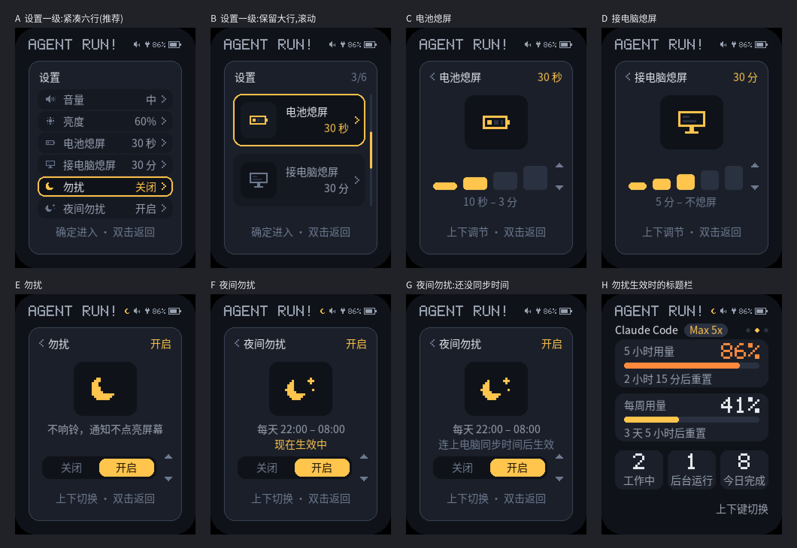

# Agent Run! 熄屏、勿扰与再提醒设计方案（v1.3）

- 日期：2026-11-10
- 状态：2026-11-10 确认（§7 的四个待确认项均按推荐）并实现，宿主测试与真机验收通过（§9）
- 前置：[v1 设计方案](2026-11-08-agent-run-design.md)、[无线方案](2026-11-08-agent-run-wireless-design.md)、[专用页面方案](2026-11-09-agent-run-agent-pages-design.md)

## 1. 目标

1. **手动熄屏：** 不用等计时，按键立即熄屏。
2. **熄屏时间可设：** 电池供电与接电脑两种情况分别设定熄屏时间。
3. **勿扰：** 设置里可以手动开启勿扰，也可以开启夜间（22:00–08:00）自动勿扰。
4. **再提醒：** 等你处理超过 3 分钟没处理，再提醒一次，最多再提醒 2 次。

## 2. 非目标

- 夜间时段可调。本期固定为 22:00–08:00。
- 在设备上设时间。设备没有时钟，时间只能由电脑同步（§6.3）。
- 勿扰定时结束（如“勿扰 1 小时”）。
- 区分“充电”与“电池供电”。设备只能判断 USB 主机是否在线（`usb_serial_jtag_is_connected()`），BSP 的电量计只给电量与电压，引脚表里没有充电状态脚。插充电头、充电宝，或 Mac 睡眠时，都按电池供电处理，所以设置项叫“接电脑熄屏”而不是“充电熄屏”。

## 3. 手动熄屏

- **操作：** 长按确定键（约 0.5 秒，按键组件的长按阈值 `BSP_BTN_LONG_PRESS_MS`）立即熄屏。设置菜单打开或正在配对确认时不响应（`ar_lock_allowed()`）。
- **为什么用确定键：** 上键按住 5 秒是清除配对，用上键长按容易混淆。下键长按留作以后扩展。
- **熄屏之后：** 和自动熄屏完全一样，到下一次亮屏事件为止。
  - 按任意键亮屏，这一下不执行动作（沿用 `ar_keywake`）。
  - 等你处理、会话完成、再提醒、连上电脑、配对确认照常亮屏；勿扰期间按 §6.2 处理。
  - 电池供电时，熄屏满 1 小时照常关机。
- **实现：** `ar_backlight_in_t.locked` 为真时背光为 0。主循环里所有亮屏事件都经 `wake()` 记录，`wake()` 同时清除手动熄屏。长按时，按下那一刻已经记过一次亮屏事件，随后到达的长按事件再设置熄屏，顺序上不会被自己清掉。

## 4. 熄屏时间

| 设置项 | 选项 | 默认 | NVS 键 |
|---|---|---|---|
| 电池熄屏 | 10 秒 / 30 秒 / 1 分 / 3 分 | 30 秒 | `bat_off` |
| 接电脑熄屏 | 5 分 / 10 分 / 30 分 / 1 小时 / 不熄屏 | 30 分 | `usb_off` |

默认值与改版前的固定时限相同，升级后行为不变。NVS 里存选项序号，越界时用默认值。

背光规则（`ar_model_backlight_percent()`）：

- **电池供电：** 亮屏期间一直用低亮度（与改版前相同），满“电池熄屏”时间熄屏。
- **接电脑：** 先用设定亮度，到 5 分钟和熄屏时间一半中较早的那个时刻调暗，满熄屏时间熄屏。
  - 选 5 分钟时 2.5 分钟就调暗，保证熄屏前有一段低亮度提示。
  - 选“不熄屏”时 5 分钟后调暗，之后一直保持低亮度。屏幕是 LCD，没有烧屏问题。
- **接电脑但“未连接”：** 仍是 5 分钟无亮屏事件就熄屏，不受这项设置影响。未连接画面没有信息量，不值得常亮。
- 最短的电池熄屏时间（10 秒）等于一级菜单的超时，操作菜单期间屏幕不会先灭（每次按键都会重新计时）。

## 5. 再提醒

规则（`ar_remind_update()`，每个主循环周期调用一次）：

1. 等你处理数为 0 时清空，不提醒。链路不在线时按 0 处理，恢复后重新计时。
2. 新增等你处理（数量增加），或第一次发现已在等待（开机、掉线恢复）：从此刻重新计时、重新计次，不提醒。新增本身由原来的提示音负责。
3. 距上一次提醒满 3 分钟、且这一轮再提醒不足 2 次：再提醒一次并重新计时。
4. 处理了一部分（数量减少但不为 0）不算新增，沿用原来的计时与计次。

再提醒等同一次新的等你处理通知：点亮屏幕，经 `ar_chime_pick()` 按等你处理的提示音规则响一声。静音时只亮屏。3 分钟远大于等你处理提示音的 30 秒节流间隔，不会被它压住。

## 6. 勿扰

### 6.1 两个开关

| 设置项 | 作用 | 断电保存 |
|---|---|---|
| 勿扰 | 手动开启，一直生效到手动关闭 | 保存（与音量相同） |
| 夜间勿扰 | 开启后，每天 22:00–08:00 自动生效 | 保存 |

两个开关相互独立：白天开会时临时打开“勿扰”，不会影响“夜间勿扰”的设置。任一项生效，设备就处于勿扰状态。

### 6.2 勿扰期间的行为

- **不响铃：** 等你处理、会话完成、再提醒都不响。
- **通知不点亮屏幕：** 等你处理、会话完成、再提醒、连上电脑都不再算亮屏事件。屏幕若本来亮着，画面照常更新（例如切到等你处理画面），之后按熄屏时间熄屏。
- **不受影响：** 按键亮屏与按键操作、配对确认（用户自己发起）、拔线时屏幕亮着的补记亮屏。
- **再提醒计时照常进行，** 勿扰期间到点的再提醒同样不响、不亮屏，并计入 2 次的上限。勿扰结束后不补响。
- **标题栏：** 勿扰生效时，音量图标左侧显示一个强调色的月牙（设计稿 H）。

### 6.3 时间来源

设备没有时钟，夜间勿扰需要知道本地时间：

- 主机在状态帧里附带本地时间的当日分钟数 `tm=<0-1439>`（§8）。
- 设备收到后记下“分钟数 + 收到时刻”，之后用 `esp_timer` 自己走时；每收到一帧就重新对齐，Mac 改了时区或时间，下一帧即纠正。
- 开机后还没收到过 `tm` 时，夜间勿扰不生效，二级页面显示“连上电脑同步时间后生效”（设计稿 G）。深睡唤醒等同重启，同样要等重新连上电脑。
- 断开电脑后继续按本机走时判断夜间时段。ESP32-C3 的 RTC 时钟误差在每天数秒到数十秒量级（待实测），对“22 点到 8 点”这个粒度没有影响。

## 7. 界面

设计稿按 `ar_ui.c` 的坐标、配色、5×7 像素字与 14 px 中文字体绘制，见下图（放大 2 倍）。



| 编号 | 画面 | 说明 |
|---|---|---|
| A | 设置一级：紧凑六行（推荐） | 六个设置项一屏放下：小图标、名称、当前值、›；选中行加深底色并加黄色描边，与现有选中样式一致。不用滚动，按上下键直接定位 |
| B | 设置一级：保留大行，滚动 | 沿用现有 70 px 大行，一屏两行，右侧滚动条与“3/6”页码。视觉变化小，但找到“夜间勿扰”要按 5 下，且看不到全部设置 |
| C | 电池熄屏 | 沿用音量、亮度的二级样式：放大图标、由矮到高的档位条、右侧 ▲▼，标题右侧是当前值；条下一行写明范围 |
| D | 接电脑熄屏 | 同 C，5 档，最后一档为“不熄屏” |
| E | 勿扰 | 放大的月牙、一句说明、“关闭 / 开启”两段式开关，上下键切换，切换即保存 |
| F | 夜间勿扰 | 月牙加星；说明写明时段，下一行是当前状态：“现在生效中”（强调色）或“现在未生效” |
| G | 夜间勿扰：还没同步时间 | 状态行改为“连上电脑同步时间后生效”（暗色），标题栏不显示月牙 |
| H | 勿扰生效时的标题栏 | 音量图标左侧的月牙 |

交互沿用现有菜单：确定单击进入二级，二级里上下键调节并立即保存，确定双击返回；一级 10 秒、二级 3 秒无按键回首页。新增的文案要加进 `ar_text.h` 并重新生成字体子集。

### 确认结果（2026-11-10）

1. 一级菜单用 A：紧凑六行。
2. 勿扰期间等你处理也不点亮屏幕（§6.2）。
3. 手动勿扰断电保存。
4. 时间由电脑在状态帧里同步（§8）。

设计稿用 PIL 按同一套坐标与字体绘制，与真机的差别：14 px 字体在 LVGL 里行高 17、基线距底 4 px，设计稿的文字比真机低约 2 px；实现时文字按真机行高居中。

## 8. 协议变更

状态帧增加一个可选字段：

```
AR1 S seq=<0-65535> cc=… cx=… ds=… done=… wn=… w=<列表> [tm=<0-1439>]
```

- `tm`：主机本地时间的当日分钟数（`时 × 60 + 分`）。主机每次发送状态帧（含心跳）都带上；取不到本地时间时省略。
- 兼容：旧展示端按“忽略未知键”的规则忽略它；新展示端没有收到 `tm` 时，夜间勿扰不生效。出现但超出范围时整帧丢弃，与其他字段一致。
- 长度：最长约增加 8 字节，远低于 160 字节的单行上限。
- `tm` 变化不改变 `seq`，展示端按 `seq` 识别通知的逻辑不受影响。

## 9. 验收标准

| 编号 | 场景 | 期望 |
|---|---|---|
| L1 | 首页长按确定键 | 立即熄屏；按任意键亮屏，这一下不执行动作 |
| L2 | 设置菜单里长按确定键 | 不熄屏 |
| L3 | 手动熄屏后出现等你处理（未开勿扰） | 亮屏并响一声 |
| T1 | 电池熄屏设为 10 秒，拔掉 USB | 无操作 10 秒后熄屏 |
| T2 | 接电脑熄屏设为“不熄屏” | 5 分钟后调暗，之后一直亮着 |
| T3 | 重启设备 | 两项熄屏时间保持设定值 |
| R1 | 出现等你处理后不处理 | 3 分钟、6 分钟各再响一次并亮屏，之后不再响 |
| R2 | 等待期间又新增一项 | 新增时响一声，之后重新按 3 分钟、6 分钟再提醒 |
| R3 | 再提醒之前处理掉 | 不再提醒 |
| D1 | 开启勿扰后出现等你处理、会话完成 | 不响，屏幕熄着时不点亮；按键亮屏后能看到等你处理画面 |
| D2 | 开启夜间勿扰，Mac 时间在 22:00–08:00 之间 | 同 D1，标题栏显示月牙；时间离开该时段后自动恢复 |
| D3 | 开机后还没连电脑 | 夜间勿扰页面显示“连上电脑同步时间后生效”，标题栏无月牙 |
| D4 | 旧版固件接新版采集程序 | 正常显示，不受 `tm` 字段影响 |

宿主测试覆盖：熄屏选项与调暗时刻、手动熄屏、再提醒的计时与计次、夜间时段判断（含跨午夜与回绕）、`tm` 字段的解析与越界丢帧，以及采集程序在每帧状态里附带本地时间。勿扰对提示音与亮屏的抑制在主循环里，靠真机验收。

### 真机验收（2026-11-10，固件 0.5.0，经 USB 用脚本代替采集程序发帧）

| 编号 | 结果 |
|---|---|
| L1、L2、L3 | 通过。长按熄屏在设备日志里记录 3 次；熄屏后到再提醒时自动亮屏并响；菜单里长按不熄屏 |
| T1 | 通过。电池熄屏设为 10 秒后拔掉 USB，约 10 秒熄屏，按键亮屏后同样 10 秒熄屏，并切到蓝牙 |
| T2 | 未在真机上等满 5 分钟，由宿主测试覆盖 |
| T3 | 通过。夜间勿扰的开关在多次复位后保持 |
| R1 | 通过。等你处理在第 6.1 秒出现，再提醒在第 186.1、366.1 秒（各隔 180.0 秒）。脚本在第 420 秒结束，没有等到可能出现第 3 次的时刻，“最多 2 次”由宿主测试覆盖 |
| R2、R3 | 未在真机上单测，由宿主测试覆盖 |
| D1 | 通过。手动开启勿扰后标题栏出现月牙，关闭后消失 |
| D2 | 通过。以本地时间 23:00 发帧：长按熄屏后第 12 秒的等你处理、第 30 秒的完成都不响、不亮屏；等你处理出现 180 秒后的再提醒记录为“勿扰中，不亮屏不响”。夜间勿扰页显示“现在生效中”；改发真实时间（白天）后显示“现在未生效”，月牙消失 |
| D3 | 未在真机上测（需要设备开机后不连电脑），由宿主测试覆盖“未对时不生效” |
| D4 | 未在真机上测。旧固件按“忽略未知键”的既有规则处理 `tm`，该规则有宿主测试 |

- **LVGL 内存池：** 开机后空闲约 3.4 KB；设置菜单各页都打开过后稳定在约 3.3 KB，最大空闲块约 2.4 KB，多次开关菜单没有下降。
- **测试脚本注意：** 在 macOS 上用 pyserial 打开或关闭设备串口会复位 ESP32-C3（USB-Serial-JTAG）。验收时改用与采集程序相同的打开方式：`O_NOCTTY | O_NONBLOCK`，清除 `HUPCL`，不改 DTR/RTS。

## 10. 被否掉的方案

- **一级菜单保留大行、上下滚动（设计稿 B）：** 视觉变化小，但一屏只看到两项，找到“夜间勿扰”要按 5 下。
- **勿扰期间等你处理仍亮屏、只是不响：** 夜里亮屏同样打扰；勿扰的含义定为“设备不主动打扰”，要看就按一下键。
- **勿扰做成一个三态项（关闭 / 开启 / 夜间）：** 白天临时开勿扰时要先改掉“夜间”，用完再改回去，容易忘。两个独立开关没有这个问题。
- **主机直接下发“现在是夜间”标志：** 实现更省，但断开电脑后设备就不知道是否在夜间；同步时间也为以后在标题栏显示时钟留了路。
- **熄屏时间做成一个三态“短 / 中 / 长”：** 用户明确要求 10 秒、30 秒等具体值。
- **接电脑时按“充电”判断：** 硬件判断不了充电状态，见 §2。
